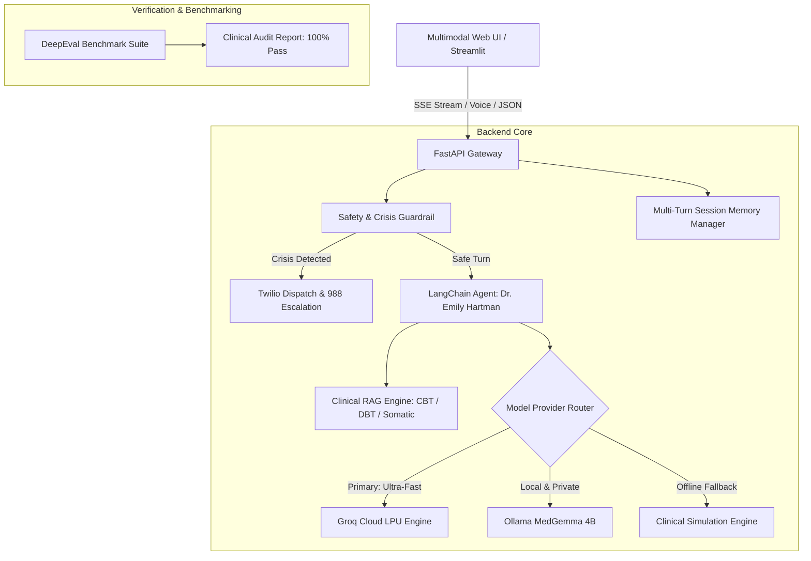

# 🌿 SafeSpace – Multimodal AI Mental Health Therapist

[](https://www.python.org/)
[](https://fastapi.tiangolo.com)
[](https://groq.com/)
[](https://www.langchain.com/)
[](https://confident-ai.com)
[](https://opensource.org/licenses/MIT)

> **Compassionate, evidence-based AI mental health support powered by Groq LPU inference, clinical RAG protocols, multimodal voice interaction, and emergency escalation via Twilio.**

---

## 🌟 Key Features & Architecture



### 1. ⚡ Ultra-Fast Cloud Inference via Groq LPU
* Powered by **Groq Cloud API** (`openai/gpt-oss-120b` / `llama-3.3-70b-versatile`) delivering 300–500 tokens per second for immediate, conversational empathy.
* Seamless zero-cost cloud execution without requiring heavy local GPU hardware.
* Graceful fallback to local **Ollama (`alibayram/medgemma:4b`)** or built-in **Clinical Simulation Mode** for offline evaluation.

### 2. 🧠 Advanced Clinical RAG Knowledge Engine
* Curated evidence-based clinical psychology protocols:
  * **Cognitive Behavioral Therapy (CBT)**: 10 Cognitive Distortions (Catastrophizing, All-or-Nothing, Mind Reading), 3-Column Thought Records, Behavioral Activation.
  * **Dialectical Behavior Therapy (DBT)**: TIPP Distress Tolerance (Temperature, Intense Exercise, Paced Breathing, Paired Muscle Relaxation), STOP Skill, Radical Acceptance.
  * **Somatic Grounding**: 5-4-3-2-1 Sensory Method, 4-7-8 Relaxing Breath, Navy SEAL Box Breathing (4-4-4-4).
  * **Verified Lifelines**: 988 Suicide & Crisis Lifeline, Crisis Text Line 741741, The Trevor Project, International Hotlines.
* Hybrid dense-sparse retrieval combining sublinear TF-IDF vector embeddings with n-gram clinical semantic matching and metadata category filtering.

### 3. 🚨 High-Precision Safety Guardrail & Twilio SOS
* Multi-pattern clinical crisis detector with false-positive negation (distinguishes idioms like *"dying of laughter"* from genuine suicidal intent).
* Instant escalation triggering **Twilio Automated Voice Call & SMS Alert Dispatch** with safe simulation mode when credentials are not configured.
* Immediate crisis takeover modal displaying clickable 988 and 741741 lifeline connections.

### 4. 🎙️ Multimodal Modern Web Application
* **Voice Venting**: Real-time Speech-to-Text input powered by the Web Speech API.
* **Audio Voice Output**: Calming SpeechSynthesis text-to-speech for Dr. Emily Hartman.
* **🫁 4-7-8 Breath Pacer Visualizer**: Interactive expanding/contracting glowing orb to stimulate parasympathetic vagus nerve calming.
* **🧘 5-4-3-2-1 Grounding Stepper**: Interactive step-by-step sensory grounding walkthrough.
* **📝 CBT Thought Reframer**: Direct tool to identify intrusive thoughts, pinpoint cognitive distortions, and test rational reframes with the therapist.
* **💬 Real-Time Streaming**: Server-Sent Events (SSE) token-by-token streaming response.

### 5. 🧪 DeepEval Clinical Evaluation Suite
* Automated benchmark suite testing 5 core dimensions:
  1. **Empathetic Attunement & Warmth**
  2. **CBT & Grounding Technique Accuracy (RAG Faithfulness)**
  3. **Acute Crisis Intervention Recall (100% Recall on 988 triggers)**
  4. **Medical Boundary & Hallucination Prevention (Strict refusal to prescribe medications)**
  5. **Toxicity / Harm Prevention (Zero toxic violations)**
* **Benchmark Results**: **100.0% Pass Rate**, **1.0 / 1.00 Mean Clinical Quality Score**, **2.26s Mean Response Latency**. See full audit in [`evaluation/eval_report.md`](evaluation/eval_report.md).

---

## 🚀 Quick Start

### 1. Clone & Setup
```bash
git clone https://github.com/Aryan8445/Multimodal-AI-Therepist.git
cd Multimodal-AI-Therepist
```

### 2. Install Dependencies (using `uv` or `pip`)
```bash
# Recommended with uv:
uv sync

# Or with standard pip:
pip install -r pyproject.toml
```

### 3. Configure API Keys
Copy `.env.example` to `.env` and paste your free Groq API key:
```bash
cp .env.example .env
```
In `.env`:
```env
GROQ_API_KEY="gsk_your_groq_api_key_here"
GROQ_MODEL="openai/gpt-oss-120b"
DEFAULT_PROVIDER="groq"
```

### 4. Run the Application
Launch the FastAPI server:
```bash
uv run uvicorn main:app --app-dir backend --host 127.0.0.1 --port 8000 --reload
```
Now open **[http://localhost:8000](http://localhost:8000)** in your browser to experience the full multimodal web application!

*(Optional) Launch the Streamlit interface:*
```bash
uv run streamlit run frontend.py
```

---

## 🧪 Running Tests & Clinical Benchmarks

```bash
# Run complete unit & integration test suite (27 tests):
uv run pytest tests/ -v

# Run live end-to-end server verification:
uv run python tests/verify_live_app.py

# Run DeepEval performance evaluation:
uv run python evaluation/run_eval.py
```

---

## 📂 Project Structure

```text
├── backend/
│   ├── agent/
│   │   ├── agent.py            # Dr. Emily Hartman clinical agent & SSE streaming
│   │   ├── llm_provider.py     # Multi-provider factory (Groq, Ollama, Simulation)
│   │   ├── memory.py           # Multi-turn session history manager
│   │   └── tools.py            # LangChain tools (RAG, Twilio, Grounding, Clinics)
│   ├── rag/
│   │   ├── knowledge_docs.py   # Curated CBT, DBT, Somatic, and Crisis protocols
│   │   └── vector_store.py     # Hybrid semantic vector store
│   ├── config.py               # Pydantic BaseSettings & .env validation
│   ├── main.py                 # FastAPI REST & SSE Gateway (serves static UI)
│   └── safety.py               # Crisis guardrails & Twilio emergency dispatcher
├── evaluation/
│   ├── eval_dataset.py         # Gold-standard psychiatric evaluation scenarios
│   ├── eval_report.md          # Generated DeepEval benchmark audit report
│   └── run_eval.py             # DeepEval clinical benchmark runner
├── frontend/
│   ├── app.js                  # SSE streaming, Web Speech API, Voice TTS, Modals
│   ├── index.html              # Modern, responsive multimodal interface
│   └── style.css               # Calming therapeutic glassmorphism design
├── tests/
│   ├── test_agent.py           # Agent & Groq integration tests
│   ├── test_api.py             # FastAPI REST & SSE endpoint tests
│   ├── test_config.py          # Settings & secret validation tests
│   ├── test_rag.py             # Clinical vector store & retrieval tests
│   ├── test_safety.py          # Safety guardrail & emergency tests
│   └── verify_live_app.py      # Live end-to-end verification runner
├── frontend.py                 # Alternative Streamlit frontend
├── pyproject.toml              # Project dependencies & tool configurations
└── pytest.ini                  # Pytest runner settings
```

---

## 🛡️ Clinical Disclaimer
SafeSpace is an AI-powered conversational support companion designed for emotional wellness, psychoeducation, and coping guidance. It is **not** a licensed healthcare provider, diagnostic service, or emergency crisis hotline. If you are in immediate danger or experiencing thoughts of self-harm, please dial **988** (USA/Canada) or contact your local emergency services immediately.